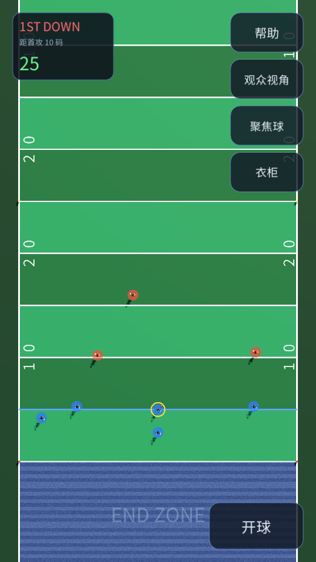
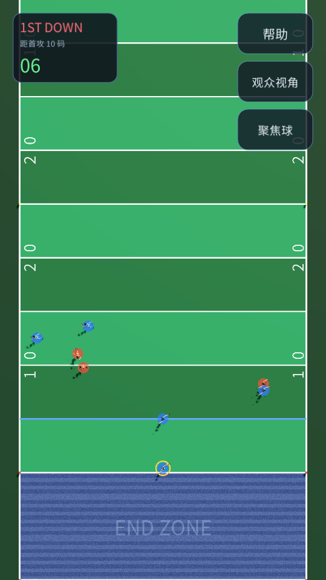
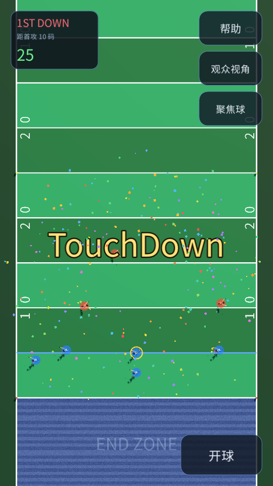
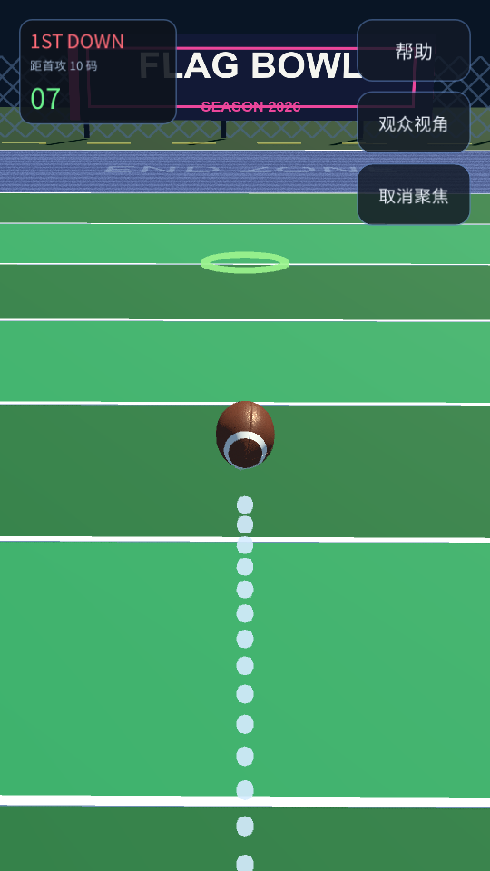
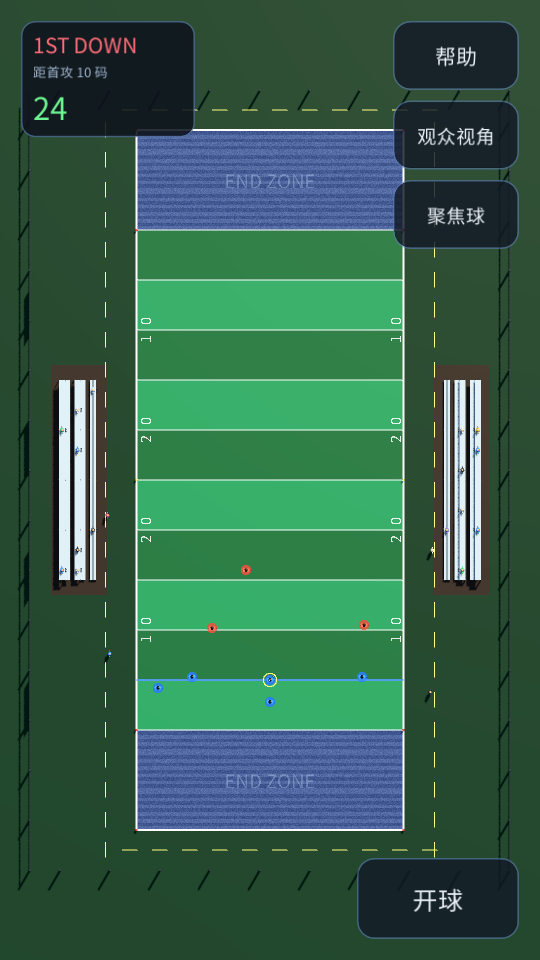
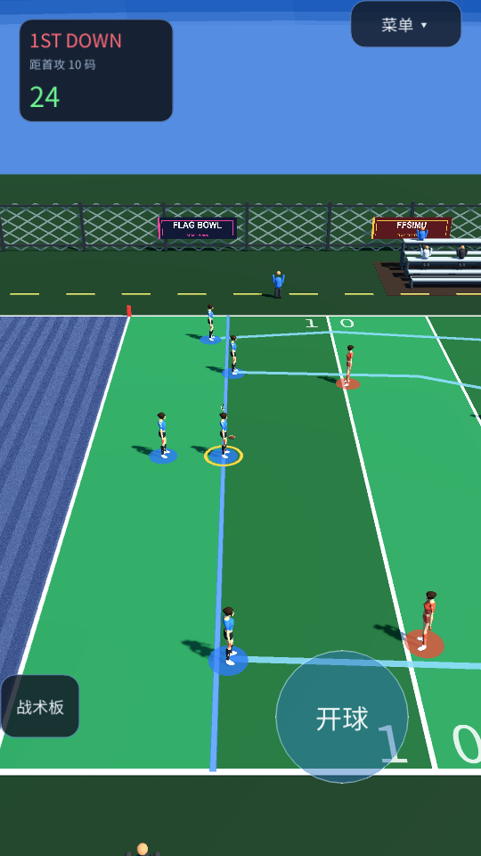
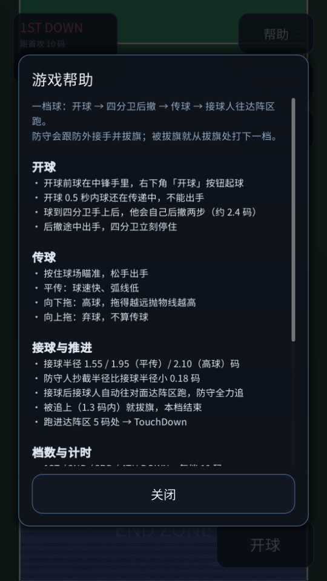

# FF

FF 是一个竖屏手机向的 Godot 4.7 橄榄球小游戏，可直接导出成网页（Netlify）在手机上玩。

- **球场 / 看台 / 围栏 / 角旗**：几何沿用 **FFSIMU**（`Desktop/flag-football-mvp`），按需求改过材质配色。
- **橄榄球 / 传球 / 档数与计时**：机制移植自 FFSIMU。
- **球员模型**：`FFfemale.fbx`（Mixamo 骨架，22 根骨骼），初始动作 `Fast Run.fbx`，髋部固定。
- **只适配手机竖屏**：720 × 1280 设计分辨率，纵向锁定。

| 开球前（1ST DOWN · 25 秒） | 开球后（后撤 + 跑路线） |
|---|---|
|  |  |

| 达阵 | 聚焦球 |
|---|---|
|  |  |

| 全场 | 观众视角 |
|---|---|
|  |  |



---

## 1. 运行

用 Godot 4.7 打开本目录（`project.godot`），F5 运行。桌面会开一个 540×960 的竖屏窗口预览。

```powershell
$g = "C:\Users\fanda\Downloads\Godot_v4.7.2-stable_win64.exe\Godot_v4.7.2-stable_win64_console.exe"
& $g --path "C:\Users\fanda\Desktop\FF"
```

### 操作

| 操作 | 作用 |
|---|---|
| 右下「开球」 | 起球（空格同样可以） |
| 按住球场 → 松手 | **平传** |
| 按住后向下拖 | **高球**，拖得越远抛物线越高 |
| 按住后向上拖 ≥ 80px | **弃球** |
| 双指拖动 / 捏合 | 临时平移（松手回中）/ 缩放 |
| 右上「帮助」「观众视角」「聚焦球」 | 帮助窗口 / 正侧方机位 / 贴到球正后方 |

---

## 2. 一档球的完整流程

```
PRE_SNAP   球在中锋手里，25 秒计时，右下「开球」亮起
   ↓ 点开球
SNAP       0.5 秒：球从中锋手里交到四分卫手上（这段时间不能出手）
   ↓
PLAY       四分卫自己后撤 2.4 码（0.8 秒）；外接手跑路线；防守人盯人跟防
           · 后撤途中一出手，四分卫立刻停住
           · 7 秒计时
   ↓
FLIGHT     球在空中，镜头跟球
   ├─ 被接住 → RUN
   ├─ 抄截   → 本档结束，下一档从原启球线开始
   └─ 没人接住 / 弃球 → 球落地弹两下 → 下一档原启球线
   ↓
RUN        接球人自动往对面达阵区跑，防守全力追
           ├─ 追到 1.3 码内 → 拔旗，下一档从**拔旗处**开始
           └─ 到达 z = 55（达阵区内侧 5 码）→ TOUCHDOWN
   ↓
TOUCHDOWN  屏幕中央弹出「TouchDown」+ 七色彩带炸开落向屏幕底端，2 秒
           结束后回到本方 5 码线、1 档
```

### 档数与计时（照搬 FFSIMU）

| 规则 | 值 |
|---|---|
| 每档推进目标 | 10 码 |
| 过中场（z > 25）或达阵 | 回到 **1 档** |
| 拔旗推进启球线 | 下一档从拔旗处开始 |
| 4 档未过 | 换攻，回到 5 码线 1 档 |
| 开球前计时 | **25 秒** |
| 开球后计时 | **7 秒**，出手即停 |
| 剩余 ≤ 5 秒 | 数字变红 |

左上角面板实时显示 `1ST DOWN`、还差多少码、以及倒计时。

### 路线

外接手在开球瞬间起跑，路线定义在 `main.gd` 的 `ROUTES`：

| 位置 | 路线 |
|---|---|
| X | 外线纵向（go） |
| Y | 浅区插入后折向内（cross） |
| Z | 斜插（slant）后折向外 |

防守人做人盯人：`COVERAGE = {CB→X, LB→Y, S→Z}`，站在接球手身后 1.6 码跟随；
一旦有人接球，三名防守全部转为追持球人。

---

## 3. 传球机制

### 参数（`scripts/pass_tuning.gd`）

| 参数 | 值 |
|---|---|
| 平传球速 | 30 m/s |
| 高球球速 | 20 m/s |
| 基础滞空 | `clamp(距离 / 球速, 0.55, 2.2)` 秒 |
| 高球弧线加成 | 拖动 40→200px，滞空放大到 ×1.9 |
| 最大传球距离 | 45 码 |

### 接球 / 抄截范围

| 项目 | 半径 |
|---|---|
| 接球（普通） | 1.55 m |
| 接球（平传） | 1.95 m |
| 接球（高球） | 2.10 m |
| 抄截 | 接球半径 **− 0.18 m** |

- 抄截概率 `0.15 + 接近度 × 0.55`（平传 +0.08），最高 90%
- 接球成功率 `0.95 − 压迫 × 0.35 − 高球 0.10`，下限 0.30
- **四分卫不能接自己传出的球**

### 球

- `start_flight` 解析弹道 → 到点后**继续飞**直到触地 → 交给物理引擎按惯性弹两下（弹性 0.45）。
- 手持/飞行期间关闭碰撞层，避免顶开球员胶囊。
- 接球后球在**右手**（`(-0.34, 1.02, 0.32)`），在躯干和手臂胶囊之外，不穿模。
- 外观：球皮用皮革贴图，**两端的白色条纹、白色防滑条、鞋带和中间球线保持白色**（FFSIMU 额外加的程序化白腰环已去掉）。

---

## 4. 竖屏 UI

| 控件 | 尺寸 | 位置 |
|---|---|---|
| 档数 + 倒计时面板 | 232 × 132 | 左上 |
| 帮助 / 观众视角 / 聚焦球 | 168 × 92 ×3 | 右上竖排 |
| 开球 | 216 × 108 | 右下 |
| 帮助窗口 | 640 × 1040 居中面板 | 可滚动 |

---

## 5. Web 导出与 Netlify 部署

**关键**：Netlify 是在它自己的构建机上找发布目录，仓库里必须已经有 `build/web`。
所以 `build/web` 要**提交进 Git**（`.gitignore` 里已经放行），并且不要配构建命令。

```powershell
$g = "C:\Users\fanda\Downloads\Godot_v4.7.2-stable_win64.exe\Godot_v4.7.2-stable_win64_console.exe"
$proj = "C:\Users\fanda\Desktop\FF"

# 重新导出（会清空 build/web）
& $g --headless --path $proj --export-release "Web" "$proj\build\web\index.html"

# 把发布用的 netlify.toml 放回构建目录
Copy-Item "$proj\netlify.toml" "$proj\build\web\netlify.toml" -Force

# 提交并推送
git -C $proj add -A
git -C $proj commit -m "Update Godot web export"
git -C $proj push
```

站点设置：

| 项 | 值 |
|---|---|
| Build command | **留空** |
| Publish directory | `build/web`（与根目录 `netlify.toml` 一致） |

如果 Build command 留空会被 Netlify 强制要求，随便填 `echo ok` 也行——它不会生成任何东西，只是让流程继续。

### 手机首屏要下载多少

| 文件 | 大小 |
|---|---:|
| `index.wasm` | 37.7 MB（Netlify 的 CDN 通常会自动 brotli/gzip 压到 **8~10 MB**） |
| `index.pck` | 4.8 MB |
| `index.js` + html + 图标 | 0.3 MB |
| **合计** | 42.8 MB（压缩后一般 **≈ 15 MB**） |

| 网络 | 首屏大约 |
|---|---|
| WiFi / 5G | 3~5 秒 |
| 4G 良好 | 8~12 秒 |
| 4G 一般（未压缩时） | 30 秒以上 |

> 如果发现首屏特别慢，说明 CDN 没有压缩 wasm，可以在仓库里加 `_headers` 并把 `index.wasm` 换成预压缩文件；
> 这里没有默认这么做，是因为一旦响应头没生效，浏览器会拿到 gzip 字节直接白屏。

### 中文字体

Godot Web 没有系统字体回退，所以内嵌 **Noto Sans SC**（OFL）子集，只保留 UI 用到的 747 个字符，
`assets/fonts/NotoSansSC-FF.otf` 只有 173 KB，通过 `project.godot` 的 `gui/theme/custom_font` 全局生效。

---
## 6. 自动化验证

```powershell
& $g --headless --path "C:\Users\fanda\Desktop\FF" --script res://tools/verify.gd
& $g --headless --path "C:\Users\fanda\Desktop\FF" --quit-after 200
```

覆盖 18 组：球场几何与配色、END ZONE 方向、竖屏与镜头、缩到最小居中、观众视角无斜角、
HUD 按钮、屏幕方向、球外观与物理、传球参数、持球位置、四分卫不接自己的球、聚焦球、
**开球前球在中锋手里**、**开球后球到四分卫且后撤约 2.4 码**、**三条接球路线**、
**开球按钮在右下且够大**、**档数/倒计时/TouchDown 覆盖层就位**、完整一档球的判定与复位。

---

## 7. 已知取舍

- **球只有 15cm**：不聚焦时就是两三个像素，飞行时有标记环 + 影子 + 落点环。
- **接球后是自动推进**：接球人按固定方向跑向达阵区，玩家不控制跑动（延续"取消选人移动"的设定）。
- **防守是简单人盯人**：跟身后 1.6 码，没有区域防守、没有路线预测。
- **倒计时到 0 没有处罚**：和 FFSIMU 一致，只是停在 00 并变红。
- **Web 首屏 ≈ 15MB**：主要是引擎 wasm（压缩后 9.6MB）。

---

## 8. 素材与授权

- `assets/models/football.glb` 与贴图来自 FFSIMU（原文件 `图片模型/球员模型/球/橄榄球.fbx`），贴图已降到 512²。
- 球场贴图来自 FFSIMU。
- 中文字体：**Noto Sans SC**，SIL Open Font License 1.1，已子集化。
